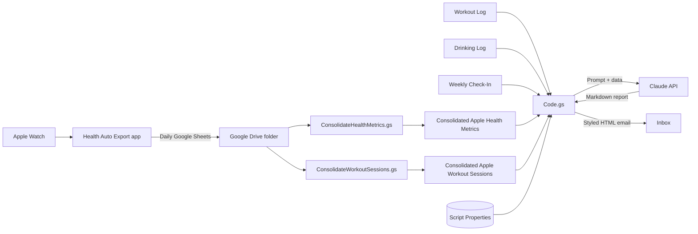

# Weekly Health Report Agent

A Google Apps Script agent that turns Apple Watch data, training logs, and weekly check-ins into a personalized health coaching report, generated by Claude and delivered to your inbox every week.

The agent pulls the last 7 days of wearable metrics, workouts, drinking, and check-in data (plus 28 days of strength training) from Google Sheets, combines it with a personal coaching prompt, and emails back a structured report that cross-references sleep, HRV, cardio zones, recovery, and self-reported readiness to surface patterns no single app shows.

## Features

- **Nine-section weekly report:** Weekly Wins, Patterns Noticed, Cardiovascular Snapshot, Recovery Signals, Drinking Patterns, Watch Outs, This Week's Focus, Strength Progress, and Check-In Summary
- **Cross-source correlation:** sleep vs. workout performance, HRV vs. drinking nights, readiness scores vs. physiological recovery
- **Progressive overload tracking** across a 28-day strength window
- **Personal context aware:** training program phase, personal Zone 2 range, medications, and optional genetic or pharmacogenomic findings
- **No secrets in code:** API key, email, sheet IDs, and the entire prompt live in Script Properties
- **Anti-hallucination rules:** the model is instructed to report "no data" rather than estimate missing numbers
- **Error alerts:** any failure sends an error email instead of failing silently

## Architecture



## Repository Contents

| File | Purpose |
|---|---|
| `Code.gs` | Main agent: loads config, reads sheets, builds the prompt, calls Claude, sends the email |
| `Setup.gs` | One-time loader that writes your values and prompt sections into Script Properties. Delete after running. |
| `ConsolidateHealthMetrics.gs` | Merges daily Health Auto Export metric files into one spreadsheet |
| `ConsolidateWorkoutSessions.gs` | Merges daily Health Auto Export workout files into one spreadsheet |
| `docs/Setup_Guide.docx` | Full step-by-step setup guide |

## Requirements

- Google account with Google Sheets, Drive, and Apps Script
- [Anthropic API key](https://console.anthropic.com) with billing enabled
- Apple Watch and iPhone with [Health Auto Export](https://healthyapps.dev) (a paid tier is required for scheduled automations)
- Apps Script V8 runtime (the default for new projects)

## Data Sources

Five Google Sheets, each with a filtered tab the agent reads:

| Sheet | Tab | Source |
|---|---|---|
| Consolidated Apple Health Metrics | `Last7Days` | Health Auto Export, via consolidation script |
| Consolidated Apple Workout Sessions | `Last7Days` | Health Auto Export, via consolidation script |
| Workout Log | `Last28Days` | Manual entry or Google Form |
| Drinking Log | `Last7Days` | Manual entry or Google Form |
| Weekly Check-In | `Last7Days` | Manual entry or Google Form |

Example filtered tab formula (raw data on a tab named `Data`, dates in column A):

```
={Data!1:1; FILTER(Data!A2:Z, Data!A2:A >= TODAY()-7)}
```

Use `TODAY()-8` for the two consolidated Apple sheets so the current partial day never reaches the report, and `TODAY()-28` for the Workout Log.

## Quick Start

### 1. Set up Health Auto Export

Create two Google Drive automations in the app, one for **Health Metrics** and one for **Workouts**:

| Setting | Value |
|---|---|
| Automation Type | Google |
| Export Format | CSV |
| Convert to Google Sheet | ON |
| Date Range | Day |
| Time Grouping | Days (Health Metrics) |
| Include Route Data | OFF (Workouts) |

Run a manual export of the last 14 days to backfill history, then confirm the file names in Drive contain `Apple Health Metrics-HealthMetrics` and `Workout session metrics`. If they differ, update the filter text in the consolidation scripts.

### 2. Install the consolidation scripts

For each consolidated spreadsheet:

1. Open **Extensions > Apps Script** and paste in the matching `Consolidate*.gs` file
2. Replace `"xxx"` with the Health Auto Export folder ID from the Drive URL
3. Make sure the consolidated data tab is the **first (leftmost) tab**
4. Run the reset function, then the consolidate function. If the log says `Paused at file X of Y`, run it again.
5. Add a daily time-driven trigger for the consolidate function

### 3. Create the report project

1. Create a new project at [script.google.com](https://script.google.com)
2. Add `Code.gs` and `Setup.gs`
3. Fill in the values and rewrite the prompt sections in `Setup.gs` for yourself
4. Run `setupScriptProperties()`
5. Run `previewPrompt()` and review the assembled prompt in the execution log
6. **Delete `Setup.gs`**
7. Run `runWeeklyHealthReport()` to send a test report
8. Add a weekly time-driven trigger (for example, Sunday 8am to 9am)

## Configuration

All configuration lives in **Project Settings > Script Properties**.

| Key | Description |
|---|---|
| `ANTHROPIC_API_KEY` | Anthropic API key |
| `EMAIL_RECIPIENT` | Address for reports and error alerts |
| `HEALTH_METRICS_SHEET_ID` | Consolidated Apple Health Metrics sheet ID |
| `WORKOUT_SESSIONS_SHEET_ID` | Consolidated Apple Workout Sessions sheet ID |
| `WORKOUT_LOG_SHEET_ID` | Workout Log sheet ID |
| `DRINKING_LOG_SHEET_ID` | Drinking Log sheet ID |
| `WEEKLY_CHECKIN_SHEET_ID` | Weekly Check-In sheet ID |
| `PROMPT_NN_<name>` | Prompt sections, assembled in numeric order |

### Prompt sections

The prompt is split across numbered properties so each stays under the roughly 9KB Script Properties limit and can be edited independently:

| Key | Contents |
|---|---|
| `PROMPT_01_PROFILE` | Who you are, goals, program and phase, cardio routine, personal Zone 2 range |
| `PROMPT_02_MEDICAL` | Medications, supplements, pharmacogenomic results (optional) |
| `PROMPT_03_GENETICS` | Consumer genetics findings (optional) |
| `PROMPT_04_TRAINING_NOTES` | Workout nutrition, injuries, volume constraints |
| `PROMPT_05_REPORT_FORMAT` | Data source descriptions and the nine report sections |
| `PROMPT_06_RULES` | Guardrails and logging conventions |

To add a section, create a new property such as `PROMPT_07_LABS`. No code change is needed. Use `{{TODAY}}` anywhere in a section to insert the run date.

### Other settings in `Code.gs`

| Setting | Default | Notes |
|---|---|---|
| `CLAUDE_MODEL` | `claude-haiku-4-5-20251001` | Swap for a larger model for deeper analysis at higher cost |
| `max_tokens` | `5000` | Adjust together with the word limit in `PROMPT_06_RULES` |

## Troubleshooting

| Symptom | Fix |
|---|---|
| `Missing script properties: ...` | Add the named keys in Script Properties |
| `Tab not found` in the log | Tab names are case sensitive: `Last7Days`, `Last28Days` |
| Section shows "No data" | Filtered tab is empty; check the formula and date format |
| Duplicate rows in a consolidated sheet | Run the reset function, clear rows below the header, rerun |
| Consolidated data landed in `Last7Days` | Move the data tab to the leftmost position |
| Health data days behind | Health Auto Export only runs while the iPhone is unlocked; open the app or charge overnight |
| Claude API authentication error | Update `ANTHROPIC_API_KEY` |

## Security and Privacy

- **Never commit `Setup.gs` with real values.** Add it to `.gitignore` if you keep a local copy.
- Apps Script keeps version history. If a key ever lived in code, rotate it in the Anthropic Console.
- Script Properties are visible to anyone with edit access to the project. Keep the project private.
- Your health data is sent to the Anthropic API on every run. Only include medical and genetic details you are comfortable sending.

Suggested `.gitignore`:

```
Setup.local.gs
*.local.gs
.clasp.json
.clasprc.json
```

## Disclaimer

This project is an analytical aid, not medical advice. It does not diagnose conditions or recommend medication changes. Discuss any concerns about medications, lab results, or symptoms with a qualified clinician.

## License

MIT. See `LICENSE`.
